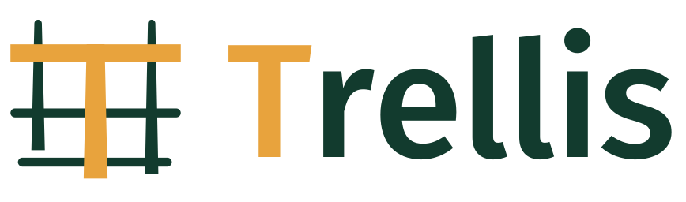
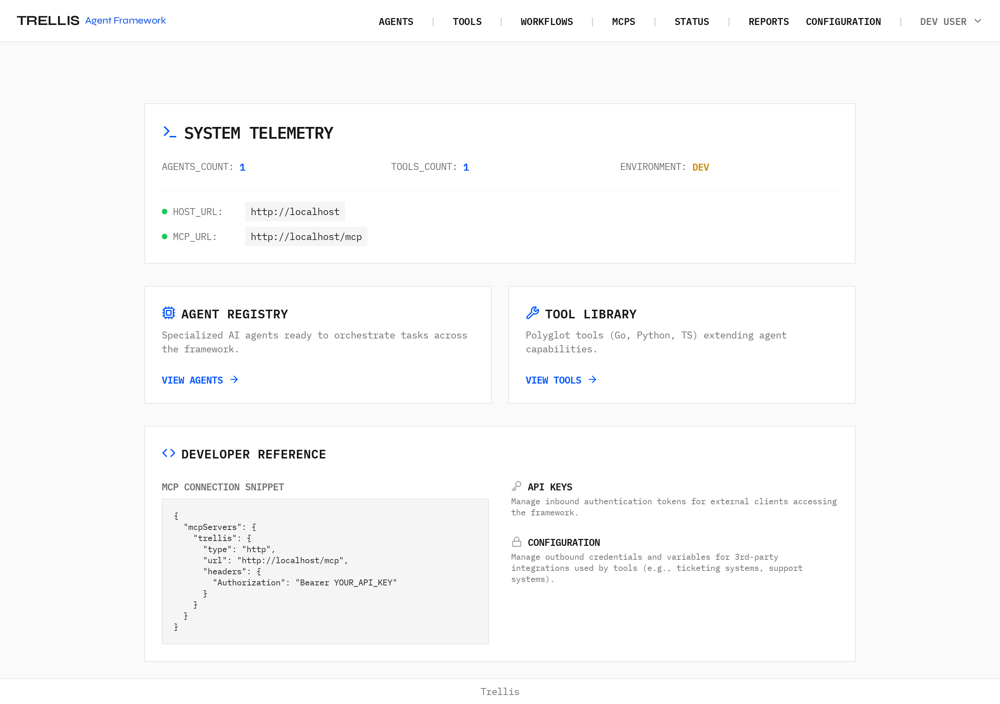
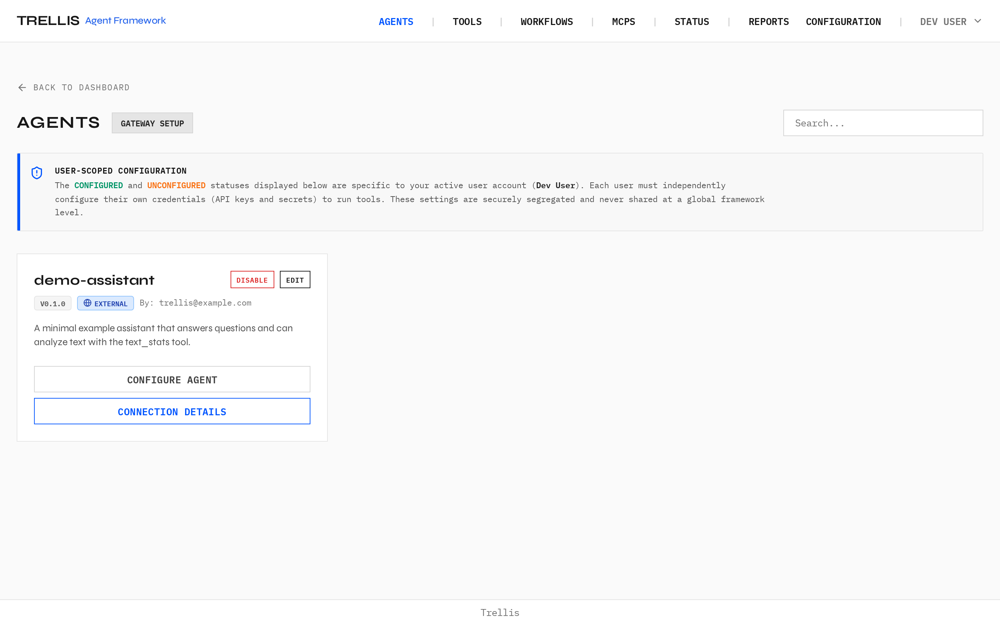
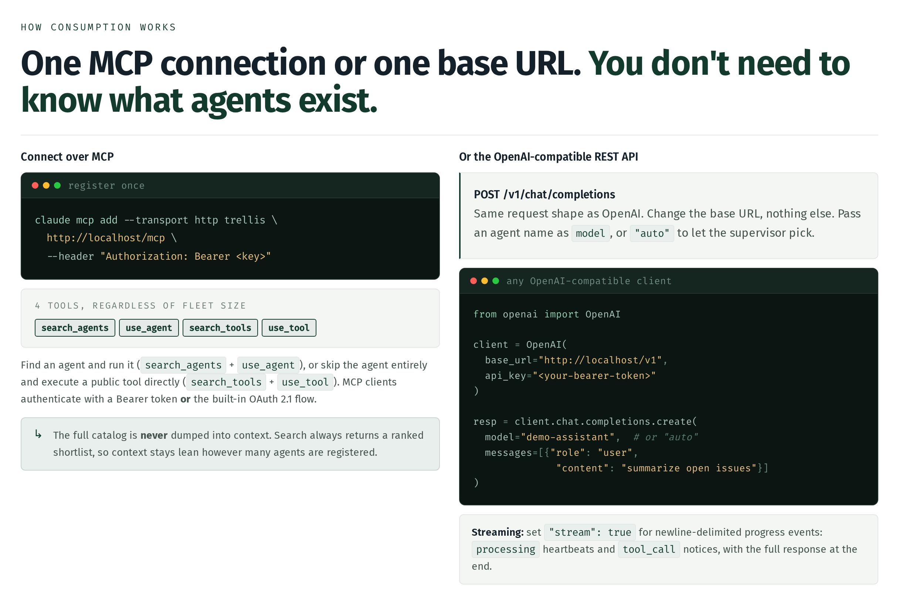

<p align="center">
  <picture>
    <source media="(prefers-color-scheme: dark)" srcset="branding/trellis-logo/svg/trellis-horizontal-on-dark.svg">
    
  </picture>
</p>

<p align="center">
  <a href="LICENSE"></a>
  
  
</p>

<p align="center"><strong>Publish AI agents once. Run them anywhere. Keep the credentials yours.</strong></p>

## Why Trellis

Most teams already have good agents. They are stuck on individual laptops and in repos, and they get rebuilt the next time the same problem comes up. At scale, three things break.

- **Skills are fragmented.** The same capability gets solved independently, with nothing to build on.
- **Nothing is discoverable.** Log investigation, root-cause analysis, and scheduled digests exist as real, working agents that most of the team has never seen.
- **Tooling is duplicated.** Every agent rebuilds its own ticketing, chat, and log wrappers, with no shared maintenance and no common interface.

So good work never compounds. A great agent helps one person once instead of becoming shared infrastructure. Trellis gives that work a home: one place to publish agents, find them, run them, and reuse their tools.

Trellis is a self-hosted control plane for a fleet of LLM agents. Teams author each agent as a config file plus a skills prompt, share one set of sandboxed tools, and reach the whole fleet through a single OpenAI-compatible endpoint or a single MCP connection. Users, credentials, routing, memory, and background jobs all run on infrastructure you own.

https://github.com/user-attachments/assets/4e36c961-5bc2-459f-9597-68330fe54d97

*The Trellis dashboard and agent fleet in 45 seconds.*

<p align="center">
  
</p>

## What you get

- **Agents as two files.** A `config.yaml` (model, tools, metadata) and a `skills.md` (the system prompt) in `workspace/agents/` is a live agent. Nothing to rewrite or containerize.
- **One endpoint, any client.** Call the fleet over `POST /v1/chat/completions`, which is OpenAI-compatible, or over a single MCP connection. Register once and every agent is reachable.
- **Predictable routing.** Plain-language `use_when` rules lock a request onto the right agent before any embedding is computed. Semantic search is the fallback, and agents can delegate to peers when a task spans specialists.
- **Shared, sandboxed tools.** A tool is a standalone script in Python, Go, TypeScript, or Bash that reads JSON on stdin and writes JSON on stdout. Build it once and reference it from any agent. Every run is wrapped in a bubblewrap sandbox.
- **Credentials injected per caller.** The same tool uses a personal token in a user session and a service-account key in a scheduled job. Scope is declared once in `tool.yaml`, so tools carry no credential logic.
- **Background work built in.** A `background_script` runs deterministic pipelines and a `background_agent` runs unattended LLM work, both triggered by cron or a signed webhook.
- **Memory that persists.** Through Hindsight, agents remember across sessions, per agent and optionally per user, behind an admin gate.
- **An admin plane, not a YAML hunt.** A dashboard manages users, API keys, tool secrets, feature flags, and LLM provider keys.
- **Self-hosted end to end.** Docker Compose brings up the whole stack and etcd holds all state. No third-party control plane sits in the request path.

<p align="center">
  
</p>

## Quick start

Docker is the only prerequisite. If you are deploying Trellis for an organization, read [docs/deploy.md](docs/deploy.md) first; it covers pointing Trellis at your own content repo.

The fastest path is the prebuilt multi-arch image, published publicly on GHCR as `ghcr.io/laraibkazi92/trellis-agent-platform` (anonymous pulls once its package visibility is public):

```bash
cp .env.example .env    # set SESSION_SECRET
docker compose pull && docker compose up -d      # prebuilt image
# or: docker compose up -d --build               # build from source
```

Orgs pin the engine to a release tag, starting with `v0.2.0` (set `TRELLIS_IMAGE` in `.env`), while `main` tracks upstream development.

Every rebuild syncs `workspace/` into etcd, so new agents and tools go live on the next one. Configure your LLM provider keys in the Dashboard under **Admin → LLM Providers** — one card per provider, covering 15 of them: Google (Gemini), OpenAI, Anthropic, DeepSeek, OpenRouter, Ollama, any OpenAI-compatible endpoint, and more. They are stored encrypted in etcd and never read from the environment. Then browse to http://localhost and create an API key, or set `DEV_MODE=true` in `.env` to run without authentication.

## Call an agent

```bash
curl -X POST http://localhost/v1/chat/completions \
  -H "Content-Type: application/json" \
  -H "Authorization: Bearer YOUR_API_KEY" \
  -d '{
    "model": "demo-assistant",
    "messages": [{"role": "user", "content": "Hello!"}]
  }'
```

Use `"model": "auto"` and a supervisor picks the agent that fits the request. Set `"stream": true` for newline-delimited progress events: `processing` heartbeats and `tool_call` notices, with the full response at the end.

## Connect an MCP client

```bash
claude mcp add --transport http trellis http://localhost/mcp \
  --header "Authorization: Bearer YOUR_API_KEY"
```

The gateway exposes four tools no matter how many agents you register: `search_agents`, `use_agent`, `search_tools`, and `use_tool`. Clients authenticate with a Bearer token or the built-in OAuth 2.1 flow. The full catalog is never dumped into context; every search returns a ranked shortlist.

<p align="center">
  
</p>

## Workspace layout

- `workspace/agents/` - one directory per agent: `config.yaml` plus a `skills.md` prompt.
- `workspace/tools/` - standalone scripts in any language with a `tool.yaml` manifest. JSON in on stdin, JSON out on stdout.
- `workspace/workflows/` - background agents and scripts triggered by schedules or webhooks.
- `workspace/mcps/` - registrations for external MCP servers.
- `workspace/shared/` - helpers shared across separate tool suites.

Scaffold the layout with `python scripts/trellis init`. To run Trellis for an organization with your own content repo, point `TRELLIS_WORKSPACE_DIR` at that checkout instead of `./workspace`; see [docs/deploy.md](docs/deploy.md).

## Architecture

| Service | Port | What it does |
| --- | --- | --- |
| Agent host (`core/host.py`) | 8000 | FastAPI + PydanticAI. Serves `/v1/chat/completions`, routes to agents, runs them. |
| Tool hub (`core/hub.py`) | 8001 | FastMCP server. Discovers tools in `workspace/tools/` and runs each in a bubblewrap sandbox. |
| MCP gateway (`core/gateway.py`) | 8002 | Exposes the agent fleet to external MCP clients at `/mcp`. |
| Dashboard UI (`core/ui.py`) | 8080 | Manage agents, tools, workflows, API keys, and tool secrets. |
| nginx gateway | 80/443 | Single front door for the stack, with optional TLS. |
| Infrastructure | internal | etcd (state registry), Redis with Taskiq (background jobs), Hindsight (agent memory). |

Ports 8000, 8001, and 8002 are not published; all traffic enters through the nginx gateway.

## Who is this for?

- **Org operators** (deploy and host the framework) - start with [docs/deploy.md](docs/deploy.md).
- **Content authors** (build agents, tools, workflows, and MCP servers) - see [docs/agents.md](docs/agents.md), [docs/tools.md](docs/tools.md), [docs/workflows.md](docs/workflows.md), and [docs/mcp.md](docs/mcp.md).
- **Framework contributors** (work on the engine itself) - see [CONTRIBUTING.md](CONTRIBUTING.md).

## Docs

- [Deploy](docs/deploy.md) - running Trellis for your org: content repos, image pinning, and TLS
- [Agents](docs/agents.md) - building agent configs and skills prompts
- [Tools](docs/tools.md) - the stdin/stdout tool protocol
- [Workflows](docs/workflows.md) - background agents and scripts
- [MCP](docs/mcp.md) - registering external MCP servers
- [CLI](docs/cli.md) - scaffold workspaces, sync the registry, inspect runs
- [Rules Engine](docs/rules_engine.md) - lock queries onto agents with plain-language rules, ahead of semantic search
- [Upgrading](docs/upgrading.md) - versioning, release tags, and breaking-change notes
- [Branding](branding/trellis-logo/GUIDELINES.md) - logo kit usage guide

## License

[Apache-2.0](LICENSE)
